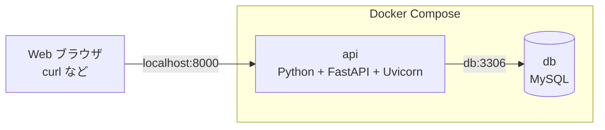
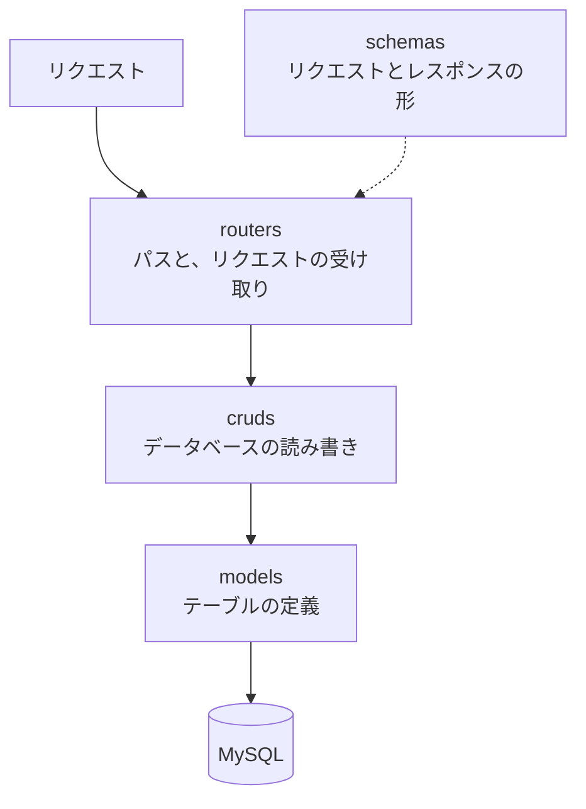

# sandbox-fastapi

FastAPI（MySQL、Docker Compose）の技術検証と、プロジェクトのひな形を兼ねたリポジトリ。

## このリポジトリについて

FastAPI で Web API を作るときの土台を、すぐ動く状態でまとめたものである。使いみちは2つある。

- **ひな形として使う**：新しいプロジェクトを始めるときに、このリポジトリから複製して、自分の機能を足していく。
- **技術検証に使う**：ライブラリの新しい版や、別の構成を試す。試した結果は、ブランチとして残す。

## ブランチ

目的の違う内容を、ブランチで分けている。

| ブランチ | 内容 | 使いみち |
| --- | --- | --- |
| [`main`](https://github.com/ike-keichan/sandbox-fastapi) | 最小の形。API は、動作の確認用の `GET /hello` だけ | 新しいプロジェクトの出発点にする |
| [`example/task-api`](https://github.com/ike-keichan/sandbox-fastapi/tree/example/task-api) | `main` に、タスクを管理する API を足した見本 | 機能の足し方の手本にする |

この README は、どのブランチでも同じ内容である。`example/` で始まるブランチには、そのブランチで足したものの説明が `docs/` に入っている。

## 技術構成

| 役割 | 使っているもの | バージョン |
| --- | --- | --- |
| 言語 | Python | 3.15 |
| Web フレームワーク | FastAPI | 0.165 |
| サーバー | Uvicorn | 0.54 |
| データベース | MySQL | 8.4（長期サポート版） |
| データベースの操作 | SQLAlchemy（非同期。ドライバは aiomysql） | 2.1 |
| パッケージ管理 | Poetry | 2.5 |
| コードの検査と整形 | Ruff | 0.17 |
| テスト | pytest、pytest-asyncio、HTTPX | 9.2 |
| 実行環境 | Docker Compose | |
| 自動テスト | GitHub Actions | |
| 依存の更新 | Dependabot | |

正確なバージョンは、[pyproject.toml](./pyproject.toml) と `poetry.lock` に記録している。

## 全体の構成

### コンテナ

Docker Compose で、2つのコンテナを動かす。



| コンテナ | 中身 | 手元からつなぐ先 |
| --- | --- | --- |
| `api` | Python と FastAPI。リポジトリのフォルダをそのまま読み込むので、`api/` のファイルを保存すると自動で再起動する | `http://localhost:8000` |
| `db` | MySQL。データは Docker のボリュームに保存され、コンテナを止めても残る | `localhost:33306` |

### プログラムの層

API のプログラムは、役割ごとに4つの層に分けている。リクエストは、上から順に流れる。



| 層 | 置き場所 | 役割 |
| --- | --- | --- |
| routers | `api/routers/` | パスとメソッドを決め、リクエストを受け取って、レスポンスを返す。処理そのものは書かず、cruds を呼ぶ |
| schemas | `api/schemas/` | リクエストとレスポンスの形を、Pydantic のモデルで決める。値の検査もここで行われる |
| cruds | `api/cruds/` | データベースの読み書きを行う |
| models | `api/models/` | テーブルの形を、SQLAlchemy のモデルで決める |

どの層も、機能ごとのディレクトリ（`hello/`、`task/` など）に分ける。機能を1つ足すときは、必要な層それぞれに、同じ名前のディレクトリを作る。

### テスト

テストでは、MySQL の代わりに、メモリ上の SQLite を使う。FastAPI の仕組み（`dependency_overrides`）で、データベースへの接続だけを差し替えている。そのため、テストは MySQL が動いていなくても実行でき、テストのたびに空の状態から始まる。

## 必要なもの

- [Docker Desktop](https://www.docker.com/products/docker-desktop/)（Docker Compose を含む）
- `make` コマンド（macOS と Linux には、最初から入っている）

Python と MySQL は、コンテナの中で動く。手元にインストールする必要はない。

## はじめかた

コマンドは、すべてリポジトリの直下で実行する。

1. Docker Desktop を起動する。
2. 環境を作る。コンテナのビルド、パッケージのインストール、テーブルの作成までを行う。

   ```sh
   make setup
   ```

3. コンテナを起動する。

   ```sh
   make up
   ```

4. Web ブラウザで <http://localhost:8000/docs> を開く。API の一覧（Swagger UI）が表示され、その場で API を試せる。
5. 終了するには、ターミナルで Ctrl + C を押す。

## コマンド

すべて [Makefile](./Makefile) に書いてある。`py/` と `db/` で始まるコマンドは、コンテナの起動中に使う。

### コンテナ

| コマンド | 内容 |
| --- | --- |
| `make setup` | 環境を作る（ビルド、パッケージのインストール、テーブルの作成） |
| `make up` | コンテナを起動する |
| `make upd` | コンテナを、バックグラウンドで起動する |
| `make stop` | コンテナを止める |
| `make restart` | コンテナを再起動する |
| `make build` | コンテナをビルドする |
| `make down` | コンテナを削除する |
| `make downv` | コンテナを、データベースの中身ごと削除する |
| `make ps` | コンテナの状態を表示する |

### 開発

| コマンド | 内容 |
| --- | --- |
| `make py/test` | テストを実行する |
| `make py/check` | コードを検査する（規則と書式） |
| `make py/fix` | 検査の指摘のうち、自動で直せるものを直す |
| `make py/add TARGET=<パッケージ名>` | パッケージを追加する |
| `make py/add-d TARGET=<パッケージ名>` | 開発用のパッケージを追加する |
| `make py/update` | パッケージを、`pyproject.toml` の範囲内で最新にする |
| `make py/install` | `poetry.lock` のとおりに、パッケージをインストールする |

### データベース

| コマンド | 内容 |
| --- | --- |
| `make db/migrate` | 全テーブルを削除して、作り直す。**データは消える** |
| `make db/reset` | `make db/migrate` と同じ |
| `make db/repl` | MySQL に接続する |
| `make db/login` | データベースのコンテナのシェルに入る |

### コンソール

| コマンド | 内容 |
| --- | --- |
| `make python/repl` | Python の対話環境を開く |
| `make python/login` | API のコンテナのシェルに入る |

## ディレクトリ構成

| ディレクトリ・ファイル | 内容 |
| --- | --- |
| `api/main.py` | 入口。ルーターを登録する |
| `api/routers/`、`api/schemas/`、`api/cruds/`、`api/models/` | プログラムの4つの層（「全体の構成」を参照） |
| `api/db.py` | データベースへの接続 |
| `api/migrate_db.py` | テーブルを作り直すスクリプト |
| `tests/` | テスト |
| `Dockerfile`、`docker-compose.yaml` | `api` のコンテナと、`db` のコンテナの定義 |
| `Makefile` | よく使うコマンドをまとめたもの |
| `pyproject.toml`、`poetry.lock` | 依存するパッケージと、そのバージョンの記録 |
| `ruff.toml` | Ruff の設定 |
| `.github/workflows/test.yml` | 自動テストの設定 |
| `.github/dependabot.yml` | Dependabot の設定 |
| `docs/` | 開発の進め方などの文書 |

## ひな形として使う

### 1. 複製する

GitHub のこのリポジトリのページで、右上の「Use this template」→「Create a new repository」を押す。

- `main`（最小の形）から始める場合は、そのまま作る。
- 見本のブランチの内容から始めたい場合は、「Include all branches」にチェックを入れて作り、作ったリポジトリでそのブランチを使う。

### 2. 名前を変える

| 場所 | 変えるもの |
| --- | --- |
| `pyproject.toml` | `name` と `description` |
| `docker-compose.yaml` | データベースの名前（`MYSQL_DATABASE` と `DB_NAME` の `demo`） |
| `Makefile` | `db/repl` の中の `demo` |
| `README.md` | 全体を、自分のプロジェクトの説明に書き換える |

### 3. 動くことを確かめる

```sh
make setup
make up
```

<http://localhost:8000/docs> が開ければ、準備は完了である。

### 4. 機能を足す

`task` という機能を足す場合を例にする。完成した形は、`example/task-api` ブランチにある。

1. `api/models/task/index.py` に、テーブルの定義を書く。
2. `api/migrate_db.py` で、そのモデルを読み込む（ファイルの中に、書き方をコメントで示してある）。
3. `api/schemas/task/index.py` に、リクエストとレスポンスの形を書く。
4. `api/cruds/task/index.py` に、データベースの読み書きを書く。
5. `api/routers/task/index.py` に、パスを書く。
6. `api/main.py` に、作ったルーターを登録する。
7. `make db/migrate` で、テーブルを作る。
8. `tests/` に、テストを書く。

不要になったら、`hello` を消す。

## 設定

データベースの接続先は、環境変数で変えられる。`docker-compose.yaml` の `api` の `environment` に書く。

| 環境変数 | 既定の値 | 内容 |
| --- | --- | --- |
| `DB_HOST` | `db` | ホスト名 |
| `DB_PORT` | `3306` | ポート番号 |
| `DB_NAME` | `demo` | データベースの名前 |
| `DB_USER` | `root` | ユーザー名 |
| `DB_PASSWORD` | （空） | パスワード |

## 開発の進め方

このリポジトリ自体を更新するときの決まり（ブランチの使い方、プルリクエスト、依存の更新、見本のブランチの保ち方）は、[docs/development.md](./docs/development.md) にまとめている。要点は、次のとおりである。

- `main` には直接コミットしない。作業用のブランチを作り、プルリクエストでマージする。
- プルリクエストを作ると、GitHub Actions がコードの検査とテストを実行する。緑になってからマージする。
- 毎週月曜に、Dependabot が依存の更新をプルリクエストで知らせる。
- `main` を更新したら、`example/` のブランチにも取り込む。

## 注意

- データベースは、パスワードなしの root でつなぐ設定である。手元で試すためのもので、公開する環境では、ユーザーとパスワードを設定する。
- `make db/migrate` は、テーブルを作り直すだけの簡単なものである。データを残したままテーブルの形を変えたい場合は、Alembic などのマイグレーションの道具を足す。
- 手元から MySQL につなぐときのポートは、`33306` である（コンテナの中では `3306`）。
