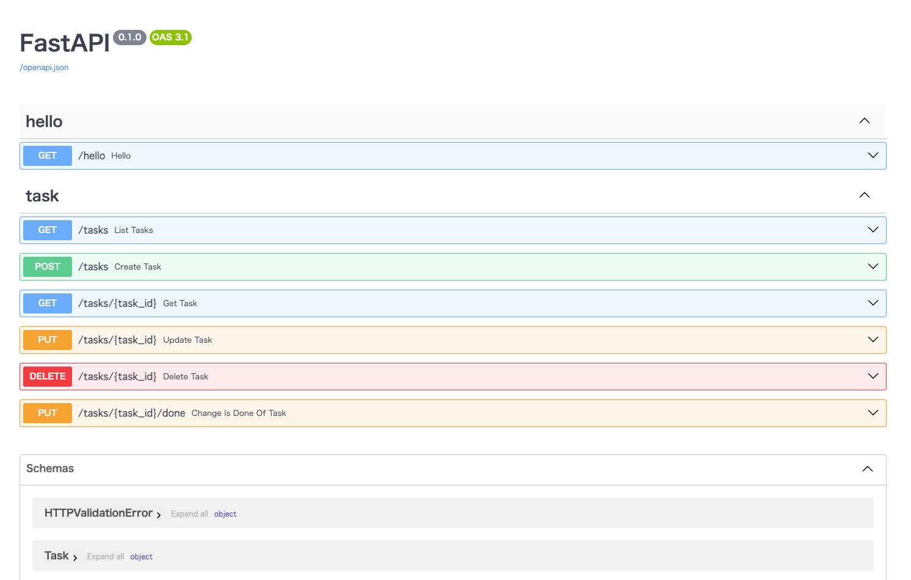

# sandbox-fastapi

FastAPI による Web API の技術検証と、プロジェクトのひな形を兼ねたリポジトリ。

> このブランチ（`example/task-api`）は、タスクを管理する API を実装した見本である。最小の形のひな形は、[`main` ブランチ](https://github.com/ike-keichan/sandbox-fastapi)にある。

タスクを管理する小さな Web API が、Docker Compose で動く状態で入っている。`main` のひな形に機能を足すときの、書き方の手本として使う。

## ブランチ

| ブランチ | 内容 |
| --- | --- |
| [`main`](https://github.com/ike-keichan/sandbox-fastapi) | 最小の形。API は `GET /hello` だけ |
| `example/task-api` | タスクを管理する API を実装した見本（このブランチ） |

## 構成

| 役割 | 使っているもの | バージョン |
| --- | --- | --- |
| 言語 | Python | 3.15 |
| Web フレームワーク | FastAPI | 0.165 |
| サーバー | Uvicorn | 0.54 |
| データベース | MySQL | 8.4 |
| データベースの操作 | SQLAlchemy（非同期。ドライバは aiomysql） | 2.1 |
| パッケージ管理 | Poetry | 2.5 |
| コードの検査と整形 | Ruff | 0.17 |
| テスト | pytest、pytest-asyncio、HTTPX（データベースは SQLite で代用） | 9.2 |
| 実行環境 | Docker Compose | |
| 自動テスト | GitHub Actions | |
| 依存の更新 | Dependabot | |

正確なバージョンは、[pyproject.toml](./pyproject.toml) と `poetry.lock` に記録している。

## 必要なもの

- [Docker Desktop](https://www.docker.com/products/docker-desktop/)（Docker Compose を含む）
- `make` コマンド（macOS と Linux には、最初から入っている）

Python と MySQL は、コンテナの中で動く。手元にインストールする必要はない。

## はじめかた

コマンドは、すべてリポジトリの直下で実行する。

1. Docker Desktop を起動する。
2. 環境を作る。コンテナのビルド、パッケージのインストール、テーブルの作成までを行う。

   ```sh
   make setup
   ```

3. コンテナを起動する。

   ```sh
   make up
   ```

4. Web ブラウザで <http://localhost:8000/docs> を開く。API の一覧（Swagger UI）が表示され、その場で API を試せる。

   

5. 終了するには、ターミナルで Ctrl + C を押す。

## API

| メソッドとパス | 内容 |
| --- | --- |
| `GET /hello` | `hello world!` というメッセージを返す |
| `GET /tasks` | タスクの一覧を返す。`?is_done=true` のように付けると、完了か未完了かで絞り込む |
| `POST /tasks` | タスクを作る。`title` と `due_date` を渡す |
| `GET /tasks/{task_id}` | タスクを1件返す |
| `PUT /tasks/{task_id}` | タスクの `title` と `due_date` を更新する |
| `DELETE /tasks/{task_id}` | タスクを削除する |
| `PUT /tasks/{task_id}/done` | タスクの完了と未完了を切り替える |

## コマンド

すべて [Makefile](./Makefile) に書いてある。`py/` と `db/` で始まるコマンドは、コンテナの起動中に使う。

### コンテナ

| コマンド | 内容 |
| --- | --- |
| `make setup` | 環境を作る（ビルド、パッケージのインストール、テーブルの作成） |
| `make up` | コンテナを起動する |
| `make upd` | コンテナを、バックグラウンドで起動する |
| `make stop` | コンテナを止める |
| `make restart` | コンテナを再起動する |
| `make build` | コンテナをビルドする |
| `make down` | コンテナを削除する |
| `make downv` | コンテナを、データベースの中身ごと削除する |
| `make ps` | コンテナの状態を表示する |

### 開発

| コマンド | 内容 |
| --- | --- |
| `make py/test` | テストを実行する |
| `make py/check` | コードを検査する（規則と書式） |
| `make py/fix` | 検査の指摘のうち、自動で直せるものを直す |
| `make py/add TARGET=<パッケージ名>` | パッケージを追加する |
| `make py/add-d TARGET=<パッケージ名>` | 開発用のパッケージを追加する |
| `make py/update` | パッケージを、`pyproject.toml` の範囲内で最新にする |
| `make py/install` | `poetry.lock` のとおりに、パッケージをインストールする |

### データベース

| コマンド | 内容 |
| --- | --- |
| `make db/migrate` | 全テーブルを削除して、作り直す。**データは消える** |
| `make db/reset` | `make db/migrate` と同じ |
| `make db/repl` | MySQL に接続する |
| `make db/login` | データベースのコンテナのシェルに入る |

### コンソール

| コマンド | 内容 |
| --- | --- |
| `make python/repl` | Python の対話環境を開く |
| `make python/login` | API のコンテナのシェルに入る |

## ディレクトリ構成

| ディレクトリ・ファイル | 内容 |
| --- | --- |
| `api/main.py` | 入口。ルーターを登録する |
| `api/routers/` | API のパスと、リクエストの受け取り |
| `api/schemas/` | リクエストとレスポンスの形（Pydantic のモデル） |
| `api/cruds/` | データベースの読み書き |
| `api/models/` | テーブルの定義（SQLAlchemy のモデル） |
| `api/db.py` | データベースへの接続 |
| `api/migrate_db.py` | テーブルを作り直すスクリプト |
| `tests/` | テスト |
| `Dockerfile`、`docker-compose.yaml` | API のコンテナと、MySQL のコンテナの定義 |
| `pyproject.toml`、`poetry.lock` | 依存するパッケージと、そのバージョンの記録 |
| `ruff.toml` | Ruff の設定 |
| `.github/` | 自動テストと、Dependabot の設定 |

`routers/`、`schemas/`、`cruds/`、`models/` は、どれも機能ごとのディレクトリ（`task/`、`hello/`）に分けている。

## ひな形として使う

新しいプロジェクトは、ふつうは `main` ブランチ（最小の形）から始める。このブランチの内容から始めたい場合は、次の手順で使う。

1. GitHub のこのリポジトリのページで「Use this template」を押し、「Include all branches」にチェックを入れて、新しいリポジトリを作る。作ったリポジトリで、`example/task-api` ブランチを使う。
2. 次の名前を、自分のプロジェクトの名前に変える。

   | 場所 | 変えるもの |
   | --- | --- |
   | `pyproject.toml` | `name` と `description` |
   | `docker-compose.yaml` | データベースの名前（`MYSQL_DATABASE` と `DB_NAME` の `demo`） |
   | `Makefile` | `db/repl` の中の `demo` |
   | `README.md` | 題名と説明 |

3. `make setup` と `make up` で、動くことを確かめる。
4. 機能を足す。`task` の4つのファイル（`routers/task/`、`schemas/task/`、`cruds/task/`、`models/task/`）を手本にして、同じ形で自分の機能のディレクトリを作る。作ったルーターは、`api/main.py` に登録する。モデルを足したら、`api/migrate_db.py` で読み込んで、`make db/migrate` を実行する。
5. 不要になったら、`task` と `hello` を消す。

## 設定

データベースの接続先は、環境変数で変えられる。`docker-compose.yaml` の `api` の `environment` に書く。

| 環境変数 | 既定の値 | 内容 |
| --- | --- | --- |
| `DB_HOST` | `db` | ホスト名 |
| `DB_PORT` | `3306` | ポート番号 |
| `DB_NAME` | `demo` | データベースの名前 |
| `DB_USER` | `root` | ユーザー名 |
| `DB_PASSWORD` | （空） | パスワード |

## 注意

- データベースは、パスワードなしの root でつなぐ設定である。手元で試すためのもので、公開する環境では、ユーザーとパスワードを設定する。
- `make db/migrate` は、テーブルを作り直すだけの簡単なものである。データを残したままテーブルの形を変えたい場合は、Alembic などのマイグレーションの道具を足す。
- 手元から MySQL につなぐときのポートは、`33306` である（コンテナの中では `3306`）。

## 自動テストと更新

- プルリクエストを作ったときと、`main` に push したときに、GitHub Actions がコードの検査とテストを実行する。コンテナを起動して、実際の MySQL につないだ状態で API を呼ぶ確認も行う。
- 毎週月曜に、Dependabot が、Python のパッケージ、Docker のイメージ、GitHub Actions のアクションの更新を、プルリクエストで知らせる。
