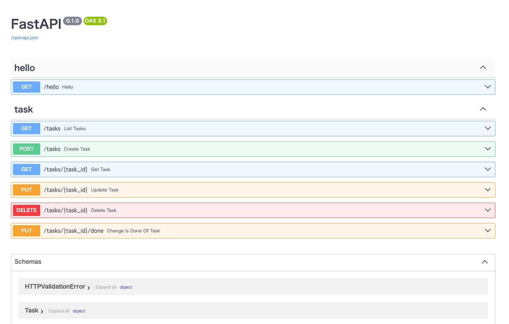

# example/task-api：タスクを管理する API の見本

`main`（最小の形）に、タスクを管理する API を足したブランチである。機能を足すときの、書き方の手本として使う。

リポジトリ全体の説明は、[README](../README.md) を参照。

## 足した API

| メソッドとパス | 内容 |
| --- | --- |
| `GET /tasks` | タスクの一覧を返す。`?is_done=true` のように付けると、完了か未完了かで絞り込む |
| `POST /tasks` | タスクを作る。`title` と `due_date` を渡す |
| `GET /tasks/{task_id}` | タスクを1件返す。ないときは 404 を返す |
| `PUT /tasks/{task_id}` | タスクの `title` と `due_date` を更新する |
| `DELETE /tasks/{task_id}` | タスクを削除する |
| `PUT /tasks/{task_id}/done` | タスクの完了と未完了を切り替える |

タスクは、次の項目を持つ。

| 項目 | 型 | 内容 |
| --- | --- | --- |
| `id` | 整数 | 自動で振られる番号 |
| `title` | 文字列 | タスク名 |
| `due_date` | 日付（`2024-09-01` の形） | 期日。なくてもよい |
| `is_done` | 真偽値 | 完了したかどうか。作った時点では `false` |

`due_date` に、存在しない日付や、形の違う文字列を渡すと、422 を返す。

## 試す

```sh
make setup
make up
```

<http://localhost:8000/docs> を開くと、タスクの API が一覧に出る。



ターミナルから試す場合は、次のようにする。

```sh
curl -X POST http://localhost:8000/tasks -H 'content-type: application/json' -d '{"title": "ラジオ体操", "due_date": "2024-09-01"}'
curl http://localhost:8000/tasks
curl -X PUT http://localhost:8000/tasks/1/done
```

## `main` に足したファイル

| ファイル | 層 | 内容 |
| --- | --- | --- |
| `api/models/task/index.py` | models | `tasks` テーブルの定義 |
| `api/schemas/task/index.py` | schemas | レスポンスの形（`Task`）と、作成・更新のリクエストの形（`TaskInput`） |
| `api/cruds/task/index.py` | cruds | タスクの作成、取得、一覧、更新、削除 |
| `api/cruds/task/done.py` | cruds | 完了の状態の更新 |
| `api/routers/task/index.py` | routers | `/tasks` と `/tasks/{task_id}` のパス |
| `api/routers/task/done.py` | routers | `/tasks/{task_id}/done` のパス |

## `main` から書き換えたファイル

| ファイル | 書き換えた内容 |
| --- | --- |
| `api/main.py` | タスクのルーターを登録した |
| `api/migrate_db.py` | タスクのモデルを読み込むようにした（読み込まないと、テーブルが作られない） |
| `tests/test_main.py` | タスクの API のテストを足した |

## 書き方の要点

- **ルーターを分ける**：`/tasks/{task_id}/done` のように、操作の種類が違うものは、ファイルを分けている（`done.py`）。分けたルーターは、`routers/task/index.py` の最後で取り込んでいる。
- **リクエストとレスポンスで、形を分ける**：リクエスト（`TaskInput`）には、利用者が決められる項目だけを入れる。`id` と `is_done` は、レスポンス（`Task`）にだけ入れる。
- **ないときは 404**：1件を対象にする API は、最初にタスクを取得して、なければ 404 を返す。
- **テストは、API を呼ぶ形で書く**：関数を直接呼ばずに、HTTP のクライアントでリクエストを送って、レスポンスを確かめる。
