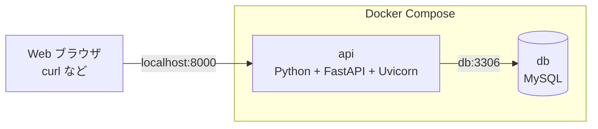
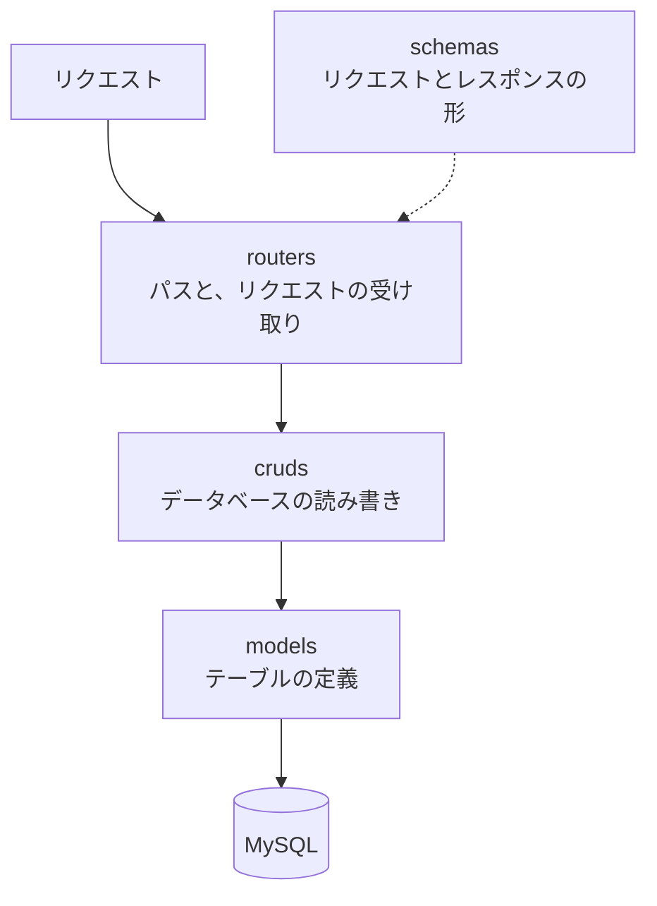

# Architecture（構成）

このリポジトリが、どういう部品でできていて、どこに何を書くのかの説明です。

- [1. コンテナの構成](#1-コンテナの構成)
- [2. プログラムの層](#2-プログラムの層)
- [3. ディレクトリ構成](#3-ディレクトリ構成)
- [4. テストの仕組み](#4-テストの仕組み)
- [5. 設定](#5-設定)
- [6. 注意点](#6-注意点)

---

## 1. コンテナの構成

Docker Compose で、2つのコンテナを動かします。定義は、[docker-compose.yaml](../docker-compose.yaml) にあります。



| コンテナ | 中身 | 手元からつなぐ先 |
| --- | --- | --- |
| `api` | Python と FastAPI。[Dockerfile](../Dockerfile) から作ります | `http://localhost:8000` |
| `db` | MySQL。公式のイメージを、そのまま使います | `localhost:33306` |

知っておくとよい点は、次の3つです。

- **ファイルを保存すると、自動で再起動します。** `api` のコンテナは、リポジトリのフォルダをそのまま読み込んでいます。`api/` の中のファイルを保存すると、サーバーが自動で再起動し、変更がすぐ反映されます。
- **パッケージは、`.dockervenv` フォルダに入ります。** コンテナを作り直しても、パッケージを入れ直さずに済むようにするためです。このフォルダは、Git の管理の対象から外しています。
- **データベースの中身は、コンテナを止めても残ります。** Docker のボリュームに保存しているためです。消すときは、`make downv` を使います。

`api` は、`db` の準備が終わるのを待ってから起動します（`docker-compose.yaml` の `healthcheck` と `depends_on`）。

---

## 2. プログラムの層

API のプログラムは、役割ごとに4つの層に分けています。リクエストは、上から順に流れます。



| 層 | 置き場所 | 役割 | 使うライブラリ |
| --- | --- | --- | --- |
| routers | `api/routers/` | パスとメソッドを決め、リクエストを受け取って、レスポンスを返します。処理そのものは書かず、cruds を呼びます | FastAPI |
| schemas | `api/schemas/` | リクエストとレスポンスの形を決めます。値の検査も、ここで行われます | Pydantic |
| cruds | `api/cruds/` | データベースの読み書きを行います | SQLAlchemy |
| models | `api/models/` | テーブルの形を決めます | SQLAlchemy |

層を分けている理由は、変更の影響を小さくするためです。たとえば、レスポンスの項目を変えるときは schemas だけ、SQL の組み立てを変えるときは cruds だけを直せば済みます。

どの層も、機能ごとのディレクトリ（`hello/`、`task/` など）に分けます。機能を1つ足すときは、必要な層それぞれに、同じ名前のディレクトリを作ります。

```
api/
├── routers/
│   ├── hello/index.py
│   └── task/index.py      ← 足す機能
├── schemas/
│   └── task/index.py
├── cruds/
│   └── task/index.py
└── models/
    └── task/index.py
```

`main` ブランチには、`routers/hello/` だけが入っています。4つの層がそろった例は、`example/task-api` ブランチにあります。

---

## 3. ディレクトリ構成

| ディレクトリ・ファイル | 内容 |
| --- | --- |
| `api/main.py` | 入口です。FastAPI のアプリケーションを作り、ルーターを登録します |
| `api/routers/` | routers の層 |
| `api/schemas/` | schemas の層 |
| `api/cruds/` | cruds の層 |
| `api/models/` | models の層 |
| `api/db.py` | データベースへの接続です。接続先の組み立て、セッションの用意、モデルの基底クラス（`Base`）があります |
| `api/migrate_db.py` | テーブルを作り直すスクリプトです。`make db/migrate` で実行されます |
| `tests/` | テスト |
| `Dockerfile` | `api` のコンテナの作り方 |
| `docker-compose.yaml` | `api` と `db` のコンテナの定義 |
| `Makefile` | よく使うコマンドをまとめたもの |
| `pyproject.toml` | 依存するパッケージと、pytest の設定 |
| `poetry.lock` | 実際にインストールされるパッケージの、正確なバージョンの記録 |
| `ruff.toml` | Ruff（コードの検査と整形）の設定 |
| `.github/workflows/test.yml` | 自動テストの設定 |
| `.github/dependabot.yml` | Dependabot（依存の更新の通知）の設定 |
| `readme/` | このリポジトリの文書 |

---

## 4. テストの仕組み

テストは、[tests/test_main.py](../tests/test_main.py) にあります。

- **API を呼ぶ形で書きます。** 関数を直接呼ばずに、HTTP のクライアント（HTTPX）でリクエストを送って、レスポンスを確かめます。
- **MySQL の代わりに、メモリ上の SQLite を使います。** FastAPI の仕組み（`dependency_overrides`）で、データベースへの接続だけを差し替えています。そのため、テストはデータベースの中身に影響せず、テストのたびに空の状態から始まります。
- **非同期のテストです。** pytest-asyncio を使っています。設定は、`pyproject.toml` の `[tool.pytest.ini_options]` にあります。

SQLite と MySQL では、動きが違う部分があります（型の扱いなど）。MySQL に特有の動きを確かめたい場合は、実際に起動して API を呼んでください。自動テスト（GitHub Actions）では、MySQL につないだ状態での API の呼び出しも行っています。

---

## 5. 設定

データベースの接続先は、環境変数で変えられます。`docker-compose.yaml` の `api` の `environment` に書きます。

| 環境変数 | 既定の値 | 内容 |
| --- | --- | --- |
| `DB_HOST` | `db` | ホスト名 |
| `DB_PORT` | `3306` | ポート番号 |
| `DB_NAME` | `demo` | データベースの名前 |
| `DB_USER` | `root` | ユーザー名 |
| `DB_PASSWORD` | （空） | パスワード |

読み込んでいるのは、[api/db.py](../api/db.py) です。

---

## 6. 注意点

- **データベースは、パスワードなしの root でつなぐ設定です。** 手元で試すためのものです。公開する環境では、ユーザーとパスワードを設定してください。
- **`make db/migrate` は、テーブルを作り直すだけの簡単なものです。** 実行すると、データは消えます。データを残したままテーブルの形を変えたい場合は、Alembic などのマイグレーションの道具を足してください。
- **手元から MySQL につなぐときのポートは、`33306` です。** コンテナの中では `3306` です。手元の MySQL と重ならないように、ずらしています。
