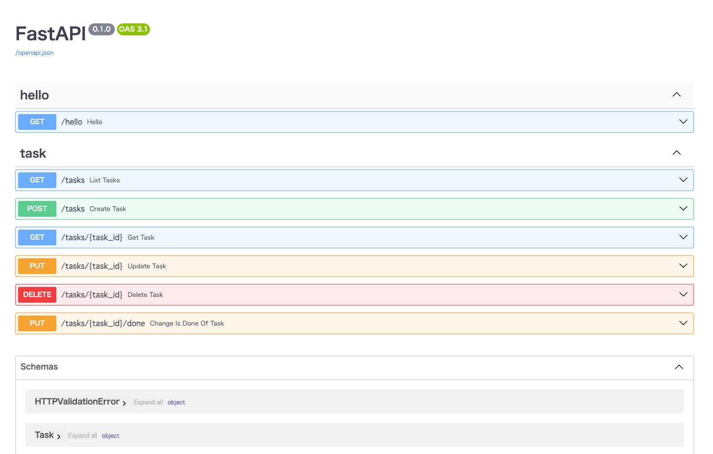

# Example: task-api（タスクを管理する API の見本）

`example/task-api` ブランチの説明です。このブランチは、`main`（最小の形）に、タスクを管理する API を足したものです。機能を足すときの、書き方の手本として使います。

リポジトリ全体の説明は [README](../README.md)、各層の役割は [Architecture](./03_ARCHITECTURE.md) を参照してください。

## 足した API

| メソッドとパス | 内容 | 成功したときの状態コード |
| --- | --- | --- |
| `GET /tasks` | タスクの一覧を、ID の小さい順に返します。`?is_done=true` のように付けると、完了か未完了かで絞り込みます | 200 |
| `POST /tasks` | タスクを作ります。`title` と `due_date` を渡します | 201 |
| `GET /tasks/{task_id}` | タスクを1件返します | 200 |
| `PUT /tasks/{task_id}` | タスクの `title` と `due_date` を更新します。渡さなかった `due_date` は、空になります | 200 |
| `DELETE /tasks/{task_id}` | タスクを削除します | 204（本文なし） |
| `PUT /tasks/{task_id}/done` | タスクを完了にします | 200 |
| `DELETE /tasks/{task_id}/done` | タスクを未完了に戻します | 200 |

タスクは、次の項目を持ちます。

| 項目 | 型 | 内容 | 渡すとき |
| --- | --- | --- | --- |
| `title` | 文字列 | タスク名。1文字以上、1024文字以下 | 必須 |
| `due_date` | 日付（`2024-09-01` の形） | 期日 | なくてもよい |
| `id` | 整数 | 自動で振られる番号 | 渡せません |
| `is_done` | 真偽値 | 完了したかどうか。作った時点では `false` | 渡せません（`/done` の API で変えます） |

うまくいかなかったときは、次の状態コードを返します。

| 場面 | 状態コード |
| --- | --- |
| 指定した `task_id` のタスクがない | 404 |
| `title` がない、空、1025文字以上、文字列でない | 422 |
| `due_date` が、存在しない日付や、形の違う文字列である | 422 |
| `task_id` が整数でない、`is_done` が真偽値でない | 422 |

## 試す

環境構築は、[Getting Started](./01_GETTING_STARTED.md) の手順で行います。`git clone` のあとに、このブランチに切り替えてください。

```zsh
$ git switch example/task-api
$ make setup
$ make up
```

<http://localhost:8000/docs> を開くと、タスクの API が一覧に出ます。



※ 画像は、以前の版のものです。いまは、`/tasks/{task_id}/done` に `DELETE` が増えています。

ターミナルから試す場合は、次のようにします。

```zsh
$ curl -X POST http://localhost:8000/tasks -H 'content-type: application/json' -d '{"title": "ラジオ体操", "due_date": "2024-09-01"}'
{"title":"ラジオ体操","due_date":"2024-09-01","id":1,"is_done":false}

$ curl -X PUT http://localhost:8000/tasks/1/done
{"title":"ラジオ体操","due_date":"2024-09-01","id":1,"is_done":true}

$ curl 'http://localhost:8000/tasks?is_done=true'
[{"title":"ラジオ体操","due_date":"2024-09-01","id":1,"is_done":true}]

$ curl http://localhost:8000/tasks/999
{"detail":"Task not found"}
```

## `main` に足したファイル

| ファイル | 層 | 内容 |
| --- | --- | --- |
| `api/models/task/index.py` | models | `tasks` テーブルの定義と、タスク名の長さの上限 |
| `api/schemas/task/index.py` | schemas | 作成と更新で受け取る形（`TaskInput`）と、レスポンスの形（`Task`） |
| `api/cruds/task/index.py` | cruds | タスクの作成、取得、一覧、更新、削除 |
| `api/cruds/task/done.py` | cruds | 完了の状態の更新 |
| `api/routers/task/index.py` | routers | `/tasks` と `/tasks/{task_id}` のパス |
| `api/routers/task/done.py` | routers | `/tasks/{task_id}/done` のパス |
| `api/routers/task/dependencies.py` | routers | 「パスの `task_id` からタスクを取得して、なければ 404」という、共通の前処理 |
| `tests/test_task.py` | | タスクの API のテスト |

## `main` から書き換えたファイル

| ファイル | 書き換えた内容 |
| --- | --- |
| `api/main.py` | タスクのルーターを登録しました |
| `api/models/__init__.py` | タスクのモデルを読み込むようにしました（読み込まないと、テーブルが作られません） |
| `scripts/smoke.sh` | 起動した API を呼ぶ確認に、タスクの API を足しました |

## 書き方の要点

- **リクエストとレスポンスで、形を分ける**：リクエスト（`TaskInput`）には、利用者が決められる項目だけを入れます。レスポンス（`Task`）は、それを継承して、サーバーが決める `id` と `is_done` を足します。
- **データベースの制限を、リクエストの検査にも書く**：`title` の長さの上限（1024）は、モデルの側に定数（`TITLE_MAX_LENGTH`）で置き、`TaskInput` の `max_length` でも使っています。検査がないと、長すぎる値は、データベースのエラーになり、500 が返ります。
- **共通の前処理は、依存関係にまとめる**：1件を対象にする API は、どれも「タスクを取得して、なければ 404」が必要です。`dependencies.py` の `find_task` にまとめ、ルーターでは `task: TargetTask` と書くだけで使えるようにしています。
- **ルーターを分ける**：`/tasks/{task_id}/done` のように、操作の種類が違うものは、ファイルを分けています（`done.py`）。分けたルーターは、`routers/task/index.py` の最後で取り込んでいます。
- **何度呼んでも、結果が同じになるようにする**：完了の操作は、「呼ぶたびに切り替える」のではなく、`PUT` で完了、`DELETE` で未完了、と分けています。通信の再送で2回届いても、結果が変わりません。
- **状態コードを、内容に合わせる**：作成は 201、本文を返さない削除は 204 を返します。
- **テストは、API を呼ぶ形で書く**：関数を直接呼ばずに、HTTP のクライアントでリクエストを送って、レスポンスを確かめます。成功する場合だけでなく、値が不正な場合と、見つからない場合も確かめています。

## MySQL での確認

テスト（`make py/test`）は、データベースを SQLite で代用します。SQLite は、文字列の長さの上限を検査しないので、テストだけでは、MySQL に特有の問題を見つけられません。

そのため、起動した API を実際に呼ぶ確認を、[scripts/smoke.sh](../scripts/smoke.sh) で行っています。自動テスト（GitHub Actions）から実行されるほか、手元でも実行できます。

```zsh
$ make upd
$ bash scripts/smoke.sh
```
